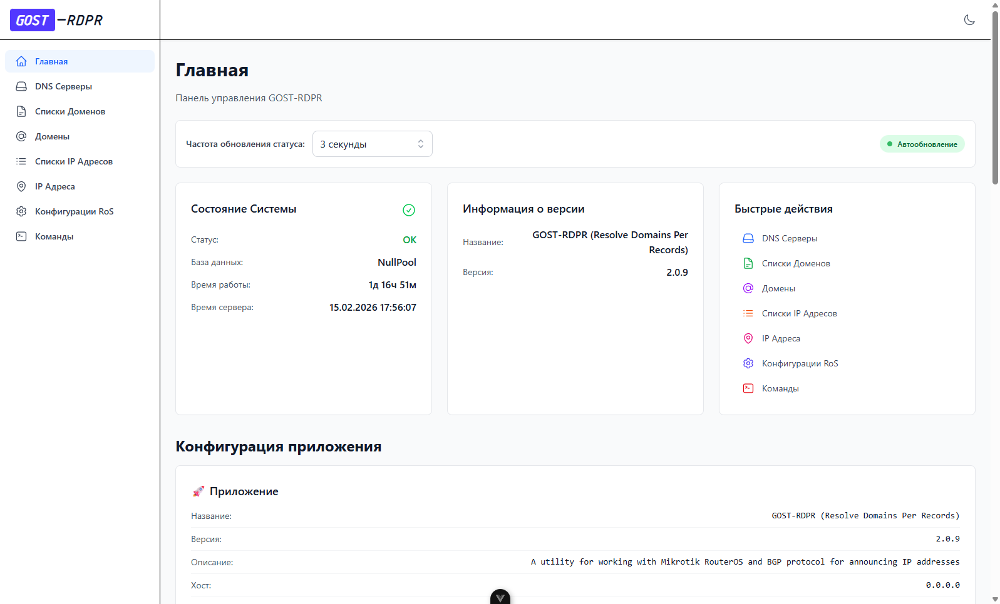
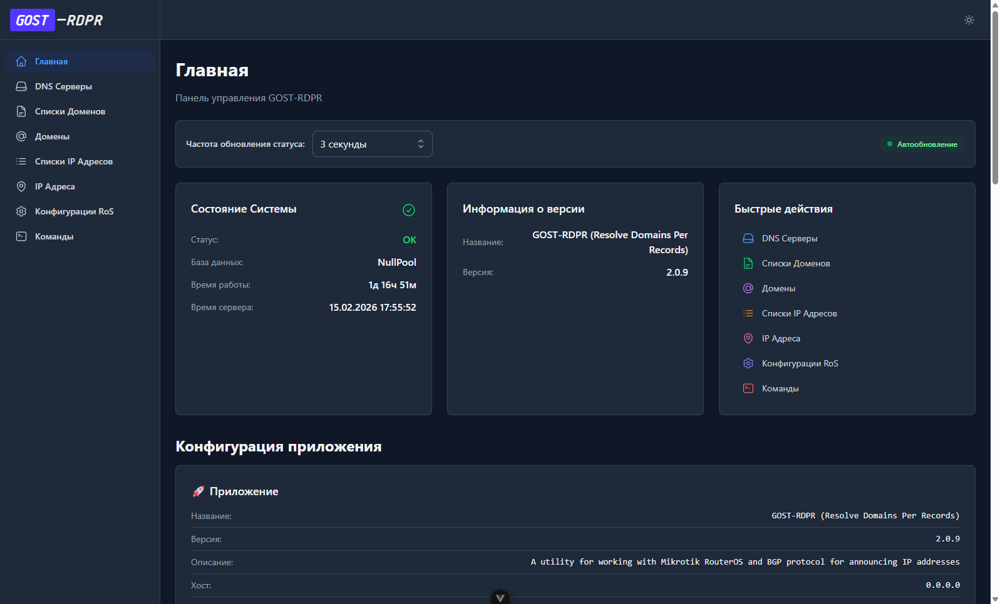
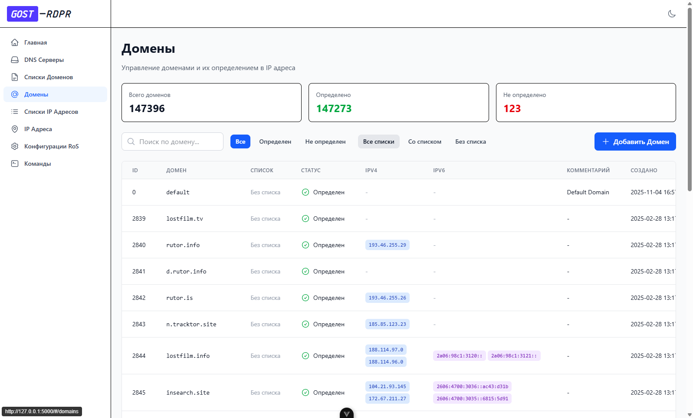
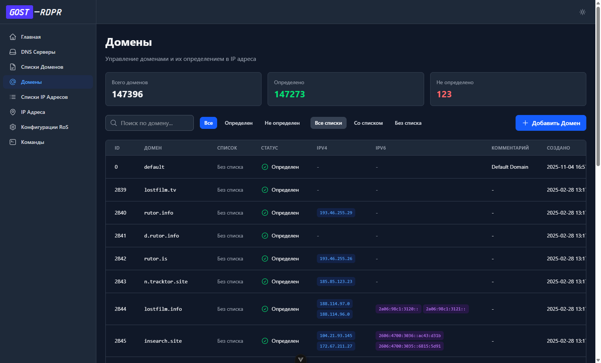

# GOST-RDPR UI

Административная панель для REST API проекта [GOST-RDPR](https://github.com/GregoryGost/gost-rdpr).

Реализует CRUD-интерфейс для управления DNS-серверами, доменами, IP-адресами,
конфигурациями RouterOS и командами с поиском, пагинацией, сортировкой и фильтрацией
таблиц, а также страницу статистики с интерактивными графиками.

## Скриншоты

<table>
  <tr>
    <td width="50%">
      
      <p align="center"><i>Главная — светлая тема</i></p>
    </td>
    <td width="50%">
      
      <p align="center"><i>Главная — тёмная тема</i></p>
    </td>
  </tr>
  <tr>
    <td width="50%">
      
      <p align="center"><i>Домены — светлая тема</i></p>
    </td>
    <td width="50%">
      
      <p align="center"><i>Домены — тёмная тема</i></p>
    </td>
  </tr>
</table>

## Быстрый старт

```bash
pnpm install
```

```bash
pnpm dev        # http://localhost:5000
pnpm build      # production сборка
pnpm type-check # проверка TypeScript
pnpm lint-dry-run # проверка ESLint без записи исправлений
pnpm format     # форматирование кода
```

> В режиме разработки запросы к `/api` автоматически проксируются к `http://127.0.0.1:4000`.
> Чтобы использовать другой backend, задайте `VITE_API_BASE_URL` в окружении процесса
> перед запуском `pnpm dev`.

## Тесты

После установки зависимостей по lockfile скачайте Chromium:

```powershell
pnpm install --frozen-lockfile
pnpm exec playwright install chromium
```

```powershell
pnpm test           # однократный запуск unit, компонентных и интеграционных тестов
pnpm test:watch     # повторный запуск при изменениях
pnpm test:coverage  # покрытие выбранных критических модулей
pnpm test:e2e       # сборка и браузерные сценарии в Chromium
```

Unit-тесты находятся в `tests/unit/`, компонентные — в `tests/components/`,
интеграционные — в `tests/integration/`. Общая очистка окружения описана в `tests/setup.ts`,
тестовые данные и вспомогательные функции — в `tests/fixtures/`.

Браузерные сценарии и управляемые ответы API находятся в `e2e/`. Команда `test:e2e` сама собирает
приложение с `VITE_API_BASE_URL=/api` и запускает отдельный preview на `http://127.0.0.1:5001`.
Порт должен быть свободен. Тесты подменяют API и не требуют рабочего backend, БД или внешних DNS-серверов.
Они проверяют frontend; настоящую интеграцию с backend нужно выполнять отдельно на изолированном стенде.

Для отладки используйте `pnpm test:watch` или `pnpm test:e2e --debug`.
Отчёт покрытия сохраняется в `coverage/`, браузерный отчёт — в `playwright-report/`,
trace и screenshots при сбоях — в `test-results/`. Покрытие включает выбранные исходники,
даже если тесты их ещё не импортировали; 100% для всего приложения не требуется.

Workflow `.github/workflows/develop-checks.yml` проверяет pull request только в `develop`:
типы, ESLint, тесты с покрытием, сборку preview и E2E в Chromium. Отчёты сохраняются как artifacts.

## Технологии

| Категория             | Технология                                     |
| --------------------- | ---------------------------------------------- |
| Framework             | Vue 3.5.45 (Composition API, `<script setup>`) |
| Язык                  | TypeScript 6.0.3                               |
| Сборщик               | Vite 8.3.8                                     |
| Стили                 | Tailwind CSS 4.3.5                             |
| UI-компоненты         | Headless UI 1.7.23, Heroicons 2.2.0            |
| Роутинг               | Vue Router 5.5.0                               |
| Управление состоянием | Pinia 4.1.0                                    |
| Линтинг               | ESLint 10.14.0 + Prettier 3.10.1                |

**Требования:** Node.js `>=26.12.1`, пакетный менеджер `pnpm 12.18.0`.

## Разделы

- **Главная** — health, версии, конфигурация, обзорные метрики, автообновление
- **DNS Серверы** — управление серверами (Classic / DoH)
- **Списки доменов** — источники доменов, попытки загрузки, статистика ошибок
- **Домены** — домены, IPv4 / IPv6, фильтры, разовая проверка через DNS-серверы и фоновый резолвинг сохранённых записей
- **Списки IP** — источники IP-адресов, IPv4 / IPv6, попытки загрузки
- **IP Адреса** — адреса (IPv4 / IPv6), связи со списками и доменами, базовый Gateway,
  проверка IPv4-префикса через RIPEstat и очистка его memory-кеша
- **Конфигурации RoS** — конфигурации RouterOS для BGP, firewall и маршрутизации
- **Команды** — загрузка списков, определение новых и устаревших доменов, обновление RouterOS в IPv4-only режиме
- **Статистика** — обзор, live-активность, динамика роста, разбивка по спискам

## Рекомендуемая IDE

[VS Code](https://code.visualstudio.com/) +
[Vue (Volar)](https://marketplace.visualstudio.com/items?itemName=Vue.volar),
[ESLint](https://marketplace.visualstudio.com/items?itemName=dbaeumer.vscode-eslint) и
[Prettier](https://marketplace.visualstudio.com/items?itemName=esbenp.prettier-vscode)

## Документация

- [Правила работы AI-агентов и профиль проекта](CODEX_PROJECT.md)
- [Руководство по разработке](docs/DEVELOPMENT.md)
- [Текущий статус проекта](docs/PROJECT_STATUS.md)
- [История изменений](docs/PROJECT_HISTORY.md)
- [OpenAPI спецификация backend](https://github.com/GregoryGost/gost-rdpr/blob/develop/docs/OPENAPI.json)
- [Документация composables](src/composables/README.md)

## Лицензия

Все исходные материалы проекта распространяются под лицензией [GPL v3](./LICENSE). Автор не
предоставляет гарантий работоспособности и не несёт ответственности за претензии или
причинённый ущерб.

## Об авторе

GregoryGost — <https://gregory-gost.ru>
